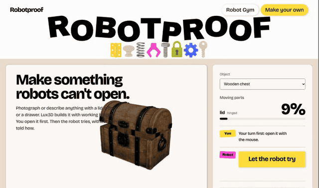
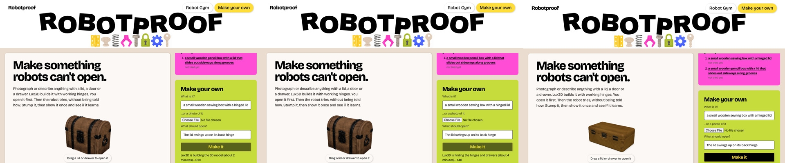
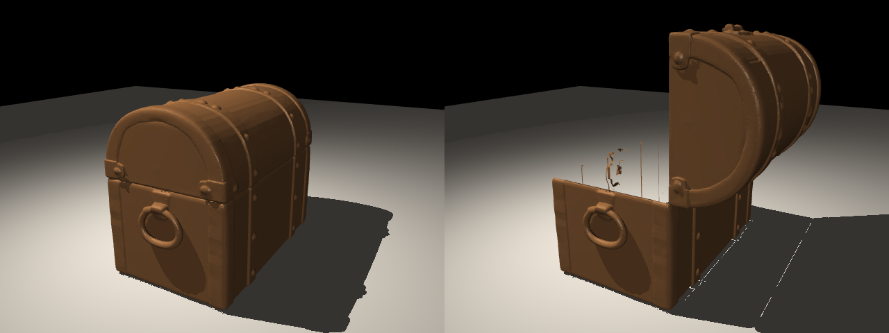

# Robotproof

**Make something robots can't open.** Photograph or describe anything with a lid, a door or a drawer. Aholo Lux3D builds it in 3D and works out how its parts move. You open it with your mouse, then a robot arm tries, without being told how it opens. When it's stumped, you can show it once and watch it copy you.

It needs Lux3D because Lux3D's articulation step returns real joints (a URDF with hinge or slide axes, limits and separate part meshes), not just a mesh. Those joints drive the physics you drag, the robot's attempts and the file you download.

**Live:** https://robotproof.vercel.app  ·  **The 94-second film:** https://qhuaqity4gffgh3y.public.blob.vercel-storage.com/film/robotproof-film.mp4 (also behind "Watch the film" on the site)

**Try it in 30 seconds**
1. Open the link. A wooden chest is already loaded.
2. Drag the front of the lid upward. It swings open on its hinge.
3. Press **Let the robot try**. It gets three attempts and doesn't know where the hinge is. On the chest it ends STUMPED.
4. Press **Teach it: let it copy you**. The arm follows the path your hand took and opens the lid.
5. Switch to the nightstand: the robot pulls both drawers out. Download either object for a robot simulator.
6. **Make your own** (top right): type or photograph something that opens and say what moves. It takes about 5 to 10 minutes and lands on the **Robot Gym** wall, where anyone can try it.

---

## How it uses Aholo Lux3D

| Lux3D feature | What it does here | Code |
|---|---|---|
| Text-to-3D and image-to-3D (G1-Turbo, 60k faces) | turns your sentence or photo into a textured model | [app/server/lux3d.ts](app/server/lux3d.ts), [app/api/make.ts](app/api/make.ts) |
| Articulation (`articulation-animation`) | takes the model and one sentence ("the lid swings up on its back hinge") and returns a URDF: part meshes, joint type, axis, limits | [app/api/job.ts](app/api/job.ts) |
| The returned URDF | becomes rigid bodies and hinge or slide joints with the same limits in browser physics (Rapier) | [app/src/urdf.ts](app/src/urdf.ts), [app/src/world.ts](app/src/world.ts) |

Lux3D's own part masses are 1.0 kg placeholders. Robotproof replaces them with an estimate (surface area × 12 mm wall × 600 kg/m³) and says so inside the downloaded file.

## Make your own, timed

A real run on the live site on 19 Nov 2026 (`tests/make_live.py`): "a small wooden sewing box with a hinged lid", "The lid swings up on its back hinge". Lux3D built the model in about 1 minute 47 seconds, articulation took about 4 minutes 50, and the object was ready at 6:40 with a revolute `lid_joint` (0 to 2.09 rad). It went straight onto the Robot Gym wall. A photo run the same morning (a stock photo of a wooden box, "Vintage wooden box on open books" by azra melek on Pexels) was ready in 3:50.

## How the robot decides

The robot is not given the joint. It sees the shape of each moving part and where it sits on the object, picks the point that sticks out most (a knob, the lip of a lid), and tries up to three moves in the order the shape suggests: lift, pull, sweep left, sweep right or push down. Its grip is a held point with a 60 N cap, and it slips if the part won't follow. An attempt counts if the part ends up more than half open. It is a scripted set of moves on a drawn arm, not a learned policy. [app/src/robot.ts](app/src/robot.ts)

**Teaching it.** While you drag, the page records where you grabbed the part (in the part's own frame) and where that point went, 30 times a second. After a STUMPED, the robot grips the same spot and follows your path, keeping only the moments where your hand got further out (a person's drag wobbles). It moves on only while the part keeps up, with the same 60 N cap and slip rule, and it still never reads the joint. Your drag also goes into the download as `demonstrations.json` (grip point, positions and open fraction over time, in the URDF's frame), the kind of record imitation-learning pipelines start from. ([app/src/robot.ts](app/src/robot.ts) `imitate`, [app/src/export.ts](app/src/export.ts))

## Check it yourself

- The live app: https://robotproof.vercel.app (chest, nightstand, and anything visitors have made)
- The chest download rendered by MuJoCo 3.3.7 itself (no browser): closed, then with its `lid_joint` set to the 1.57 rad limit Lux3D returned. Rerun: `.venv/bin/python tests/mujoco_shot.py <unzipped download> docs/mujoco-chest.png`
  
- Rerun the evidence from a fresh clone (Node 20+, Python 3 with `pip install playwright && playwright install chromium`): `./evidence/serve.sh`, then `python evidence/score.py http://localhost:5199 evidence/results.csv` and `python evidence/teach.py http://localhost:5199 evidence/teach.csv`. On 19 Nov 2026 a fresh clone reproduced both CSVs row for row.
- `./check.sh` runs the typecheck, the build, a call to the real Aholo API, a headless browser run of the demo path (drag, robot, download, with video), and loads the downloaded URDF in MuJoCo 3.3.7 and drives every joint.

## Evidence

> Evidence, stated plainly: no real users yet; it was built for this hackathon. Instead: our own break test on 28 everyday objects from a list written and committed before any run (commit 263b38c), against a random-pull baseline. Each one reruns from the repo.

> Claim: Robotproof turns a one-line description into an object whose parts open the way the sentence says in 19 of 28 cases.
> Evidence type: Our own break test, not real users.
> Data: evidence/data/prompts-v1.txt lines 3–30 (CC0, our own list), generated with Lux3D on 18 Nov 2026, n=28. Baseline: none published on this input.
> Result: 67.9% (95% interval 49.3% to 82.1%).
> Rerun: `cd app && npx tsx ../evidence/generate.mts` (regenerates with Lux3D, costs credits), or to rescore the committed objects: `./evidence/serve.sh`, then `python evidence/score.py http://localhost:5199 evidence/results.csv` at commit 6c6e368. Limits: one Lux3D build failed with no reason given, two came back with extra joint types, and six did not open past half (oven and dishwasher doors swing into the floor; some lids turn 180°).

> Claim: The robot, never told the joint, opens 4 of the 19 openable objects.
> Evidence type: Our own break test, not real users.
> Data: the 19 openable objects above, seed 20261118, n=19. Baseline: a random pull at a random point with the same force and tries opens 3 of 19 (15.8%, 95% interval 5.5% to 37.6%).
> Result: 21.1% (95% interval 8.5% to 43.3%); difference from the baseline +5.3 points (95% interval −15.8 to +26.3), so not better than random by our own rule.
> Rerun: `python evidence/score.py` and `python3 evidence/interval.py diff evidence/robot-vs-random.csv robot random_pull --seed 20261118` at commit 6c6e368. Limits: a scripted robot, not a trained policy; small n.

> Claim: Shown once how to open it, the robot opens 15 of the 19 openable objects, up from 4 without help.
> Evidence type: Our own break test, not real users.
> Data: the same 19 objects, seed 20261118, n=19. The demonstration is a stand-in for a person's drag: the scripted pull along each joint, recorded at 30 Hz as the path of the part's centre; the robot gets only that path. Baselines on the same objects: the shape-only robot opens 4 of 19 (21.1%, 95% interval 8.5% to 43.3%); the shape-only robot with the same stiff, damped hand the copy uses opens 6 of 19 (31.6%, 15.4% to 54.0%).
> Result: 78.9% (95% interval 56.7% to 91.5%); +57.9 points over shape-only (95% interval +36.8 to +78.9) and +47.4 over the same hand without the demonstration (+21.1 to +73.7), paired.
> Rerun: `./evidence/serve.sh`, then `python evidence/teach.py http://localhost:5199 evidence/teach.csv` and `python3 evidence/interval.py diff evidence/teach.csv imitate shape_only_damped --seed 20261118`. The rule was registered in evidence/EVAL_PLAN.md before the first run (commit 4ee434f); the copying hand was changed after it, logged there with the first run's CSV. Limits: the demonstration is scripted, not a person's; one try per part; four objects still failed (a two-door fridge, a pizza box, a suitcase, a two-drawer unit).

## What doesn't work yet

- A new object takes about 5 to 10 minutes: Lux3D builds the model (about 2 to 5 minutes), then finds the joints (about 4 to 5 minutes).
- Joint ranges can be off. A pencil box we asked to "slide out the full length" came back with ±3.4 cm of travel.
- Masses are estimates, not measurements, and the robot is a scripted grasp, not a trained controller.
- To keep credits for everyone, each visitor can make 3 objects a day, and the site makes at most 60 a day.
